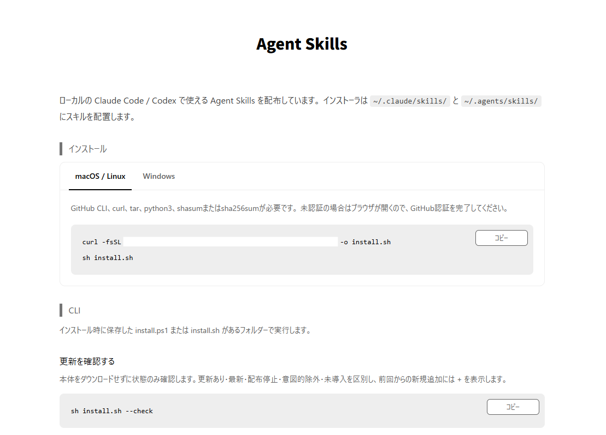
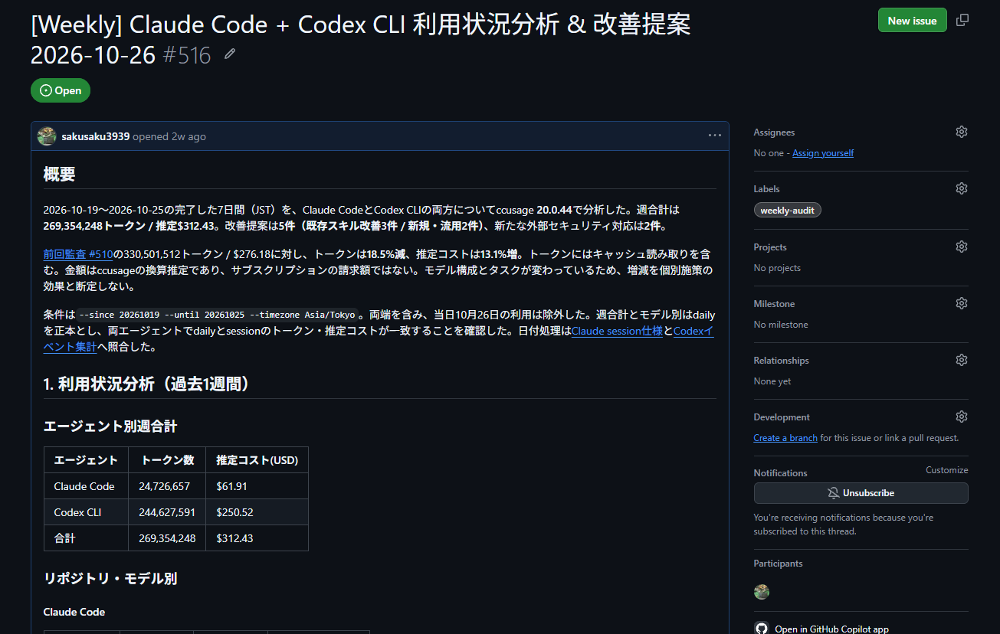

Slackでbotにメンションすると、AIエージェントが作業してスレッドに返信する個人用のAI秘書を作りました。
アプリのバグ調査や実装、研究の実験などを、チャンネルごとに専用Skillを持つエージェントに、スマホからもPCからも依頼できます。

Slackにすると便利なこと
- Xで見つけたSkillや面白い仕組みを、スマホのSlackでリンクと一緒に「これ入れといて」と送るだけで導入できる。PRをマージすると、自分のPCのCodexやClaude Codeにもskillsが自動配布される
- 「fableで」「gpt6で」と言えば途中でモデルを切り替えられるため、調査時と実装時のモデル切り替えが簡単
- スマホだけでアプリを作れる。思い付いたときに機能を足したり、バグが出たらスクショやログを直接スマホからSlackに送って調査できる
- AI秘書が自分自身を改善できる（セキュリティ対応含め）

# br-24px

# br-24px

# 仕組み
Slackからの依頼はキューに入り、自宅のMac miniで動くワーカーが受け取ります。Mac mini上でClaude CodeやCodexを起動して作業し、結果を依頼元のスレッドに返します。
定期タスクでは、AI秘書がSlackで自分自身をメンションして次の作業を依頼し、次の作業を自律的で進めることができます。GitHub Actionsを利用して指定の時間にメッセージを送っています。

# br-24px

LLMは料金体系や性能の勢力図がすぐに変わるため、使うモデルを後から差し替えられるようにしました。Claude CodeとCodex CLIでは出力形式やセッションの継続方法が異なるため、LLMアダプタという層で各CLIの出力を共通のイベントに変換し、AIエージェント本体からはその違いが見えないようにしています。使うLLMは、Slackで「fableで」「gpt6で」と一言頼むだけで切り替えられます。

# br-24px

アーキテクチャ設計とテスト戦略についての詳細は、Zennの記事「[特定モデルに依存しないAIエージェントの設計: Clean Architectureとテスト戦略](https://zenn.dev/aokiti/articles/00cd9eb7afd400)」にまとめています。

# Skillの管理
技術関連の作業や研究、スライド作成など、さまざまな用途に対応する60以上のSkills（SKILL.md）をGitHubで一元管理しています。
Slackチャンネルごとに使用するSkillsと作業リポジトリを設定ファイルで指定し、用途に応じて切り替わる仕様になっています。

また、GitHubで管理しているSkillは、手元のPCにも自動でアップデートが配布されます。必要なSkillが各PCの`.claude/skills/`や`.agents/skills/`に入ることで、全ての所有PCで同じSkillを使えます。

# br-24px

# 週次レポート
毎週月曜に週次レポートとして、AI秘書のトークン使用量や改善案をまとめてGitHubのIssueにまとめています。
前週からどれくらい利用量が変わったかに加え、Skillの改善案や、対応が必要なセキュリティ項目を調査し、必要なら改善まで依頼できます。

# br-24px

# 研究の自動化
仮説を立てるところから考察をまとめるところまでを自動で回しています。

各仮説と実験はGitHubのIssueとPRで管理し、PRに付けるラベルでステートマシン風に状態を表します。
ラベルが付くとGitHub Actionsが呼び出され、Slackメッセージとして自分自身をメンションして次の作業内容を送ることでSkillが発火し、自動で次のフローに進みます。

1日の流れは次のようになっています。

- 毎朝9時に、最新の論文と過去の実験記録から仮説を立ててIssueを作る（17時と23時にも、考察済みの実験から次の改善案を作る）
- AIが実装してPRを作成し、`training-queued`を付けて学習待ちにする
- 研究室のGPUサーバーが空いたら学習を開始（GPU4枚を2組に分け、2つのPRまで同時に実行）
- 失敗したらエラー内容からAIが修正し、キューに戻す
- 学習が終わったら追加の検証を行い、考察をPRにまとめて`analyzed`を付ける
# br-24px

# two-row 45.1 /posts/ai-secretary/research-slack.jpg /posts/ai-secretary/research-issue.jpg
# br-4px
# two-row 68.03 /posts/ai-secretary/research-prs.jpg /posts/ai-secretary/research-review.jpg
# br-24px

2026年4月から11月まで回したところ、以下の結果になりました。

- PR：約1,200件（うち実験のPRは約820件）
- 考察まで終わった実験：約430件
- 研究タスクの目標精度を72.06% → 81.29%まで改善
# br-8px

ほとんどの仮説は失敗に終わりましたが、仮説が外れた実験も考察としてドキュメントに残すため、次の仮説を立てるときの材料になっています。

この実験結果の一部は、[Ref-YOLO-World](https://github.com/sakusaku3939/Ref-YOLO-World/)として国際会議WACV 2027（採択率: 33.7%）に論文が採択されました。

# リンク
- 特定モデルに依存しないAIエージェントの設計: Clean Architectureとテスト戦略 - Zenn  
  https://zenn.dev/aokiti/articles/00cd9eb7afd400
