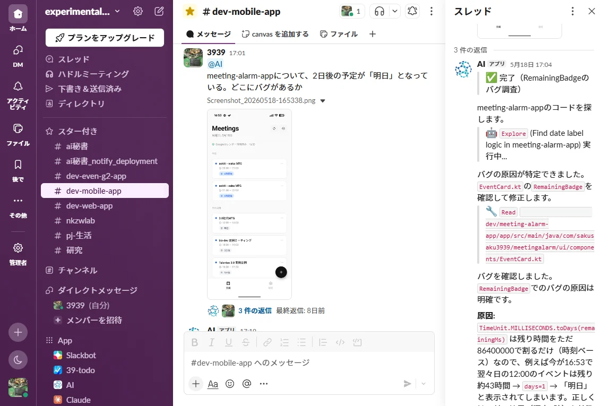
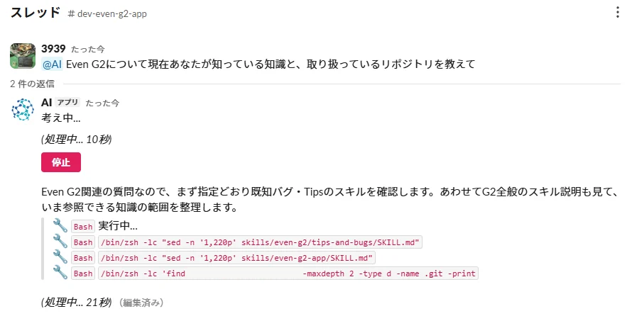
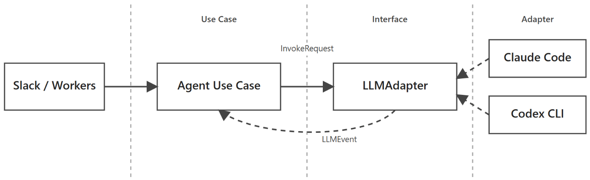

Slackでbotにメンションすると、AIエージェントが作業してスレッドに返信する個人用のAI秘書を作りました。
アプリのバグ調査や実装、研究の実験などを、チャンネルごとに専用Skillを持つエージェントに、スマホからもPCからも依頼できます。

Slackにすると便利なこと
- Xで見つけたSkillや面白い仕組みを、スマホのSlackでリンクと一緒に「これ入れといて」と送るだけで導入できる。PRをマージすると、自分のPCのCodexやClaude Codeにもskillsが自動配布される
- 「fableで」「gpt6で」と言えば途中でモデルを切り替えられるため、調査時と実装時のモデル切り替えが簡単
- スマホだけでアプリを作れる。思い付いたときに機能を足したり、バグが出たらスクショやログを直接スマホからSlackに送って調査できる
- AI秘書が自分自身を改善できる（セキュリティ対応含め）

# br-24px

# br-24px

# 仕組み
SlackのメンションはAWS Lambdaで受け取って署名を検証し、SQSに積みます。キューは自宅のMac mini上のworkerが読み取り、Claude CodeまたはCodexを起動して結果をスレッドに返す仕組みです。

# br-24px

技術関連の作業や研究、スライド作成など、さまざまな用途に対応する60以上のSkills（SKILL.md）をGitHubで一元管理しています。
Slackチャンネルごとに使用するSkillsと作業リポジトリを設定ファイルで指定し、用途に応じて切り替わる仕様になっています。

また、自作インストールスクリプトを実行すると、必要なSkillsをローカルPCの`.claude/skills/`や`.agents/skills/`にダウンロードでき、複数のPCで同じSkillsを共有できます。

# 研究の自動化
仮説を立てるところから考察をまとめるところまでを自動で回しています。

各仮説と実験はGitHubのIssueとPRで管理し、PRに付けるラベルでステートマシン風に状態を表します。
ラベルが付くとGitHub Actionsが呼び出され、Slackメッセージとして自分自身をメンションして次の作業内容を送ることでSkillが発火し、自動で次のフローに進みます。

1日の流れは次のようになっています。

- 毎朝9時に、最新の論文と過去の実験記録から仮説を立ててIssueを作る（17時と23時にも、考察済みの実験から次の改善案を作る）
- AIが実装してPRを作成し、`training-queued`を付けて学習待ちにする
- 研究室のGPUサーバーが空いたら学習を開始（GPU4枚を2組に分け、2つのPRまで同時に実行）
- 失敗したらエラー内容からAIが修正し、キューに戻す
- 学習が終わったら追加の検証を行い、考察をPRにまとめて`analyzed`を付ける
# br-24px

# two-row 45.1 /posts/ai-secretary/research-slack.jpg /posts/ai-secretary/research-issue.jpg
# br-4px
# two-row 68.03 /posts/ai-secretary/research-prs.jpg /posts/ai-secretary/research-review.jpg
# br-24px

2026年4月から11月までの成果は以下のとおりです。

- PR：約1,200件（うち実験のPRは約820件）
- 考察まで終わった実験：約430件
- 研究タスクの目標精度を72.06% → 81.29%まで改善
# br-8px

仮説が外れた実験も考察としてドキュメントに残すため、次の仮説を立てるときの材料になっています。

この実験結果の一部は、[Ref-YOLO-World](https://github.com/sakusaku3939/Ref-YOLO-World/)として国際会議WACV 2027（採択率: 33.7%）に論文が採択されました。

# モデルに依存しないAIエージェント
Claude CodeとCodex CLIは、出力形式やセッション継続の方法がそれぞれ異なります。そこでAIエージェント本体がこの違いに依存しないよう、LLMアダプタという層で各CLIの出力を共通のイベントに変換しました。使うLLMは一言で切り替えられます。

# br-24px

アーキテクチャ設計とテスト戦略についての詳細は、Zennの記事「[特定モデルに依存しないAIエージェントの設計: Clean Architectureとテスト戦略](https://zenn.dev/aokiti/articles/00cd9eb7afd400)」にまとめています。

# リンク
- 特定モデルに依存しないAIエージェントの設計: Clean Architectureとテスト戦略 - Zenn  
  https://zenn.dev/aokiti/articles/00cd9eb7afd400
