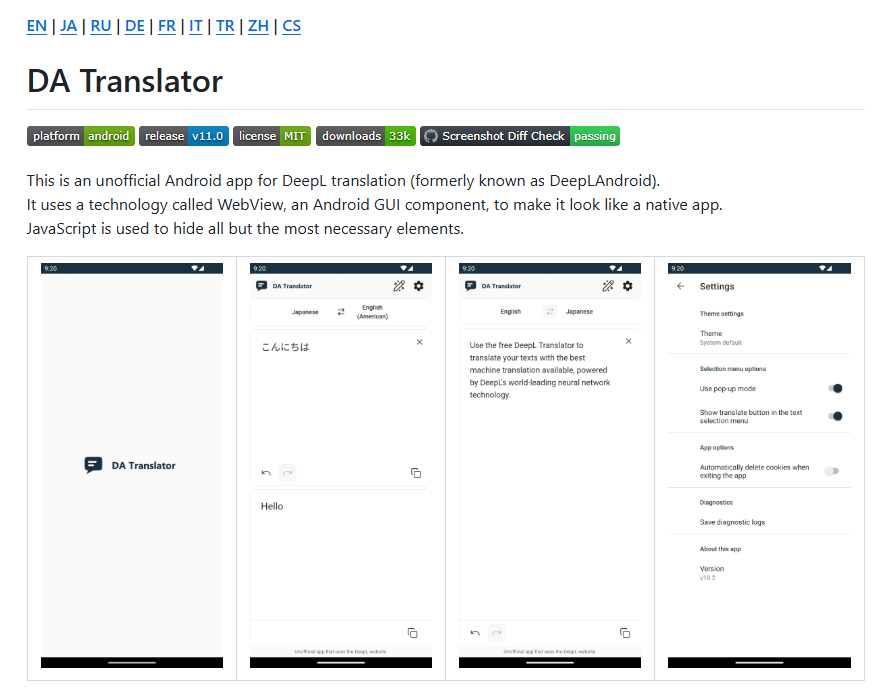
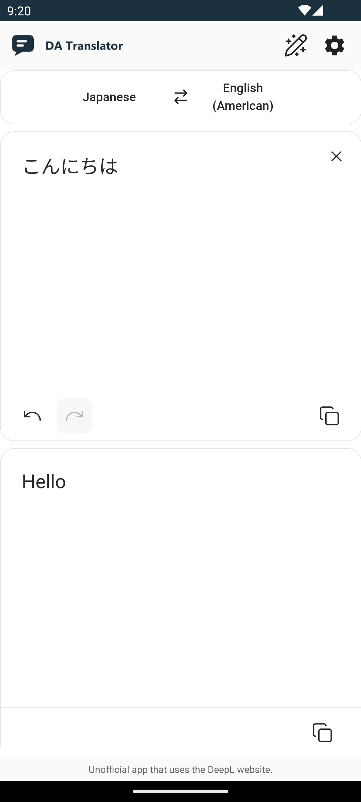
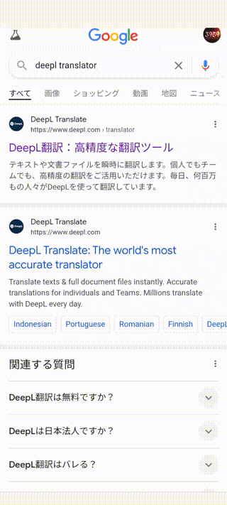
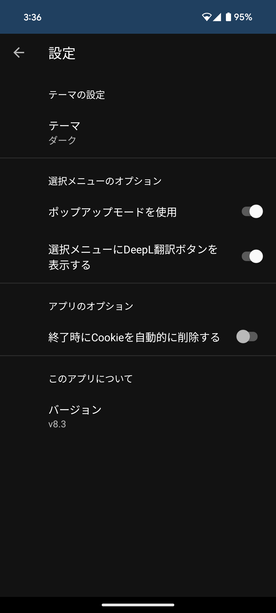
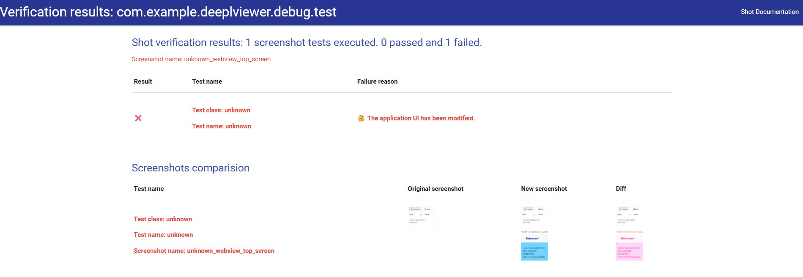
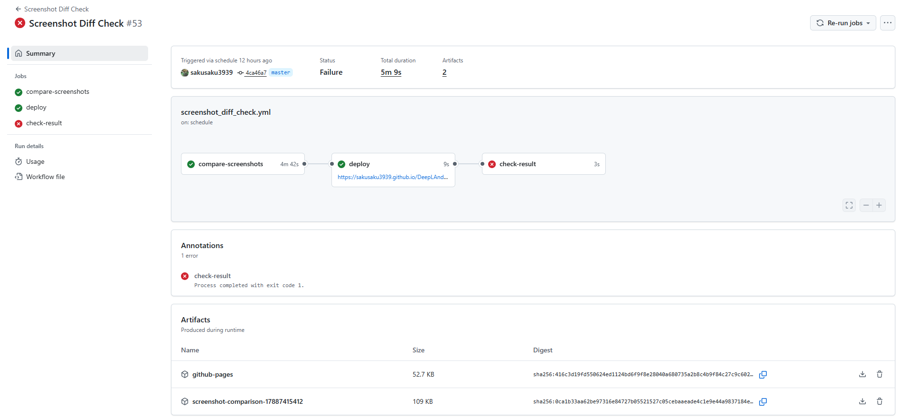
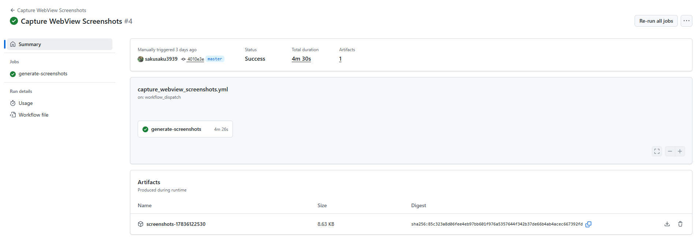

2020年の当時、DeepL公式のAndroidアプリが無く、わざわざブラウザからアクセスする必要がありました。そこで、WebViewとJavaScriptを使用したシンプルなDeepL翻訳クライアントを開発しました。

OSSアプリストアのF-Droidに公開したところ着々と反響があり、GitHubで500スターを達成しました。2025年1月時点で <a href="https://github.com/sakusaku3939/DA-Translator/issues?q=is%3Aissue+is%3Aclosed" target="_blank">68件のIssue</a> が解決され、外部のコントリビューターからも <a href="https://github.com/sakusaku3939/DA-Translator/pulls?q=is%3Apr+-author%3Asakusaku3939" target="_blank">48件のPull request</a> が寄せられました。
アプリ自体の言語は英語・日本語に加え、コントリビューターにより計11ヶ国語に対応しています。

https://github.com/sakusaku3939/DA-Translator

# 機能一覧
WebViewを使用し、必要な要素以外はJavaScriptで隠すことでネイティブアプリ風にしています。 単純な仕組みのためAPIを使用することなく、ユーザー登録や追加の設定無しでアプリを利用することができます。

| 翻訳画面のみをWebViewで表示                                | 選択メニューからDeepLアプリを起動                               | 設定画面 (ダークモードへの切り替え)                                 |
|--------------------------------------------------|---------------------------------------------------|-----------------------------------------------------|
|  |  |  |

# スクリーンショットによる表示崩れのCI検知

WebViewで表示しているDeepL翻訳のページは、不定期にデザインアップデートが入ることで要素のIDや配置が変わり、JavaScriptによる要素の非表示処理が効かなくなることがありました。結果として、ユーザーからのIssue報告を受けるまで発見が遅れ、数日間アプリが壊れた状態で放置されてしまうケースがありました。

そこで、技術的な解決策として、スクリーンショットの差分を用いたインストルメンテーションテストをCI/CDパイプラインに組み込み、定期実行によってWebViewの表示崩れを自動で検知できる仕組みを構築しました。

# br-24px

CIは以下のフローによって行われます。

① GitHub Actions上でAndroidエミュレーターを起動する
② [pedrovgs/Shot](https://github.com/pedrovgs/Shot) を用いてWebView画面のスクリーンショットを撮影
③ Shotで生成されたスクリーンショット差分ページをGitHub Pagesにデプロイ
④ 差分がある場合はCIジョブが失敗し、メールで通知

ただし、実際には対応の必要がない細かなデザイン変更も検知されてしまうことがあります。その場合でも、更新用のCIジョブを実行すれば、手作業でスクリーンショットを撮り直すことなく、新しいスクリーンショットを自動コミットできるようになっています。

# br-8px

# リンク
- リリース版 (GitHub)  
  https://github.com/sakusaku3939/DA-Translator/releases
- GitHub  
  https://github.com/sakusaku3939/DA-Translator

# 使用技術
言語 ・・・ Kotlin, JavaScript
フレームワーク、ライブラリ ・・・ WebView
