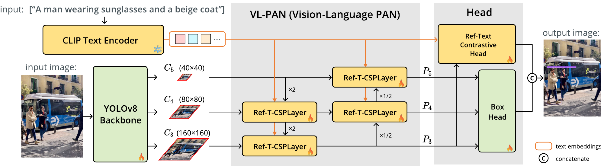

スマートフォンなどのエッジ端末上で、「サングラスをかけてベージュのコートを着た男性」のような文章から、画像内の対象物体を1つ検出する参照表現理解（REC）モデルを高速かつ高性能に動かすための研究です。
提案手法は、RefCOCOg val で Acc@0.5 81.29%、iPhone 15 Pro で 15.73 FPS の動作を両立しました。

本研究は国際会議 WACV 2027（採択率: 33.7%）の Application Track にフルペーパー採択されました。

# br-24px

# 背景と手法
近年の精度の高い参照表現理解モデルは、Qwen3-VL や ChatGPT などの MLLM を活用しています。これらの手法をエッジ端末内で動かすことは難しく、また画像と文章の両方を毎フレーム処理するため計算量が大きく、リアルタイムで動かすのが難しい点が課題でした。

高速なオープンボキャブラリー物体検出モデルの YOLO-World は、テキストを一度だけエンコードして使い回せます。ただし文章全体を1つのベクトルにまとめるため、「左の」「サングラスをかけた」といった単語ごとの手がかりを検出に反映しにくいという課題がありました。

本研究では、YOLO-World の速さを保ったまま、文章の単語（トークン）ごとの特徴を検出に使える Ref-YOLO-World を提案しました。テキスト側の処理は画像から独立させ、追加したクロスアテンションのキー・バリューの射影まで含めて、文章1つにつき1回だけ計算してキャッシュします。

文章の各トークンの特徴は、次の2つの軽量なモジュールによって取り込んでいます。

- Ref-T-CSPLayer： Neck の各段で、全トークンの特徴をクロスアテンションで参照（「左」「奥」など位置を表す言葉のため、2次元の位置埋め込みも追加）
- Ref-Text Contrastive Head： 領域とテキストのスコアを計算する前に、全トークンの文脈を各領域の特徴に追加
# br-24px

# two-row 37.3 /posts/ref-yolo-world/accuracy_fps.png /posts/ref-yolo-world/examples.png
# br-8px

（以前 MIRU 2025 でポスター発表した Dy-YOLO-World の課題をベースにした研究であり、その続きとして卒業論文で取り組んだ内容になります。）

# デモ
Core ML に変換したモデルを iPad Pro で動かした様子です。動画の再生と枠の描画も同時に行っているため、この動画では 3〜4 FPS ほどになっています。

<video src="/posts/ref-yolo-world/ipad-demo.mp4" width=300 controls autoplay muted></video>

ブラウザ上で動くデモとして Hugging Face Spaces にも公開しています。
https://huggingface.co/spaces/sakusaku3939/Ref-YOLO-World

# リンク
- 論文 (PDF)  
  [ref-yolo-world.pdf](/db/ref-yolo-world.pdf)
- GitHub  
  https://github.com/sakusaku3939/Ref-YOLO-World
- デモ (Hugging Face Spaces)  
  https://huggingface.co/spaces/sakusaku3939/Ref-YOLO-World
- モデル (Hugging Face)  
  https://huggingface.co/sakusaku3939/Ref-YOLO-World
